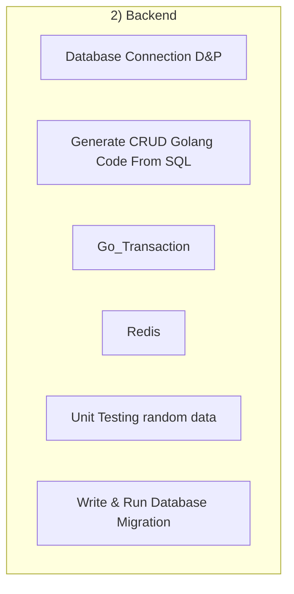

## 1. Stack
- Go (Golang) — `go.mod`/`go.sum` present in multiple subfolders under "2) Backend/"
- Docker — `docker-compose.yml` in "Database Connection D&P" and "Go_Transaction"
- sqlc — `sqlc.yaml` in "Go_Transaction"; a "4) SQLC" subfolder in "Generate CRUD Golang Code From SQL"
- No root-level manifest (no `go.mod` at repo root) — each exercise folder is its own Go module

## 2. Directory map

| path | what lives there |
|---|---|
| `README.md` | 12-week Go learning roadmap, progress checklist, DB-schema note |
| `go_learning_roadmap.json` | JSON form of the roadmap (name only — not read this pass) |
| `2) Backend/` | container for standalone Go learning/exercise modules |
| `2) Backend/Database Connection D&P/` | Go module: DB connection exercise (`main.go`, `docker-compose.yml`, `go.mod`, `go.sum`) |
| `2) Backend/Generate CRUD Golang Code From SQL/` | sqlc-based CRUD codegen exercise (`1) SQL/`, `4) SQLC/`, `learn.md`) |
| `2) Backend/Go_Transaction/` | Go DB-transactions exercise (`go.mod`, `sqlc.yaml`, `Makefile`, `db/`, `docker-compose.yml`, `Learn.md`) |
| `2) Backend/Redis/` | Redis client exercise (`redis_go_test/`) |
| `2) Backend/Unit Testing random data/` | unit-testing exercise (`files/`) |
| `2) Backend/Write & Run Database Migration/` | DB-migration exercise (`learn.md`) |

## 3. Diagram

No cross-module edges are shown: each folder has its own independent `go.mod`; no source was read that shows one module importing another.

## 4. Component index
- [[Database Connection D&P]]
- [[Generate CRUD Golang Code From SQL]]
- [[Go_Transaction]]
- [[Redis]]
- [[Unit Testing random data]]
- [[Write & Run Database Migration]]

## 5. Entry points
- Dev: `2) Backend/Database Connection D&P/main.go` — the only `main.*`/`index.*`/`app.*` file found (repo root and one level into `src/`/`app/` have none; no `src/`/`app/` dirs exist)
- Prod: TODO: verify — no build/deploy script was read (docker-compose files exist but are out of scope for this pass)

## 6. Conventions
- Exercise folders use Title Case with spaces, e.g. "Database Connection D&P", "Generate CRUD Golang Code From SQL" (observed folder names)
- One folder uses `Snake_Case`: "Go_Transaction" (observed folder name)
- Step/number prefixes appear at some nesting levels: "2) Backend", "1) SQL", "4) SQLC" (observed folder names)
- README.md documents its own edit convention: change `- [ ]` to `- [x]` and commit (README.md, "How to use this file")
- Error handling: TODO: verify — no Go source file was read this pass

## 7. Where things go
- New Go learning module: add a folder under `2) Backend/` with its own `go.mod` (mirrors "Database Connection D&P" / "Go_Transaction")
- New DB-backed exercise: follow the "Go_Transaction" pattern — `go.mod` + `docker-compose.yml` + `sqlc.yaml` + `Makefile` + `db/`
- New roadmap milestone/task: edit `README.md` checklist items (`- [ ]`) per its documented convention
- New SQL→Go codegen exercise: follow "Generate CRUD Golang Code From SQL" pattern (`SQL/` + `SQLC/` + `learn.md`)
- TODO: verify further conventions — file reading in this pass is limited to README.md, directory listing, and manifests (none found at root)
